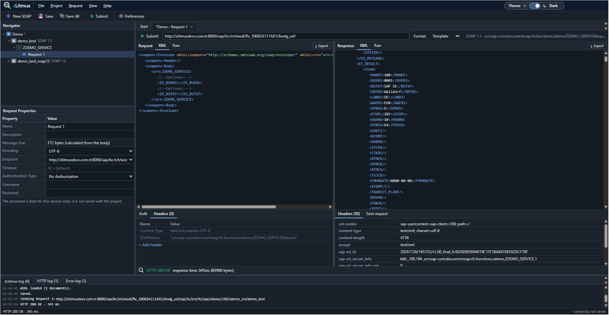
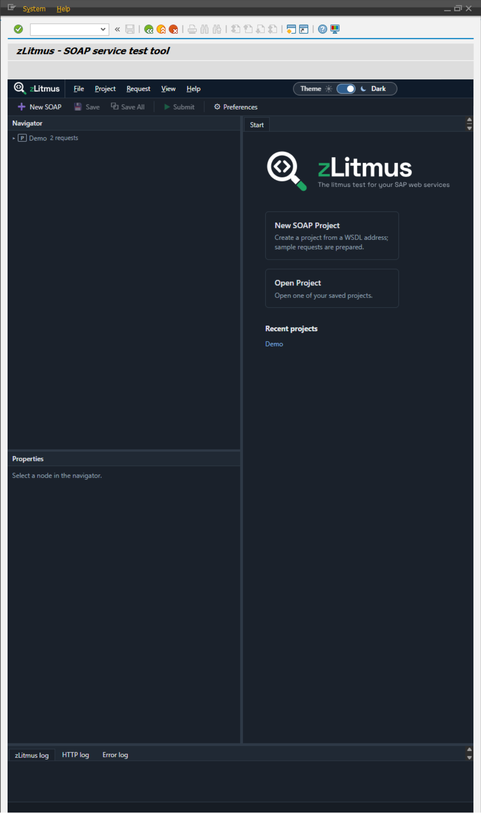
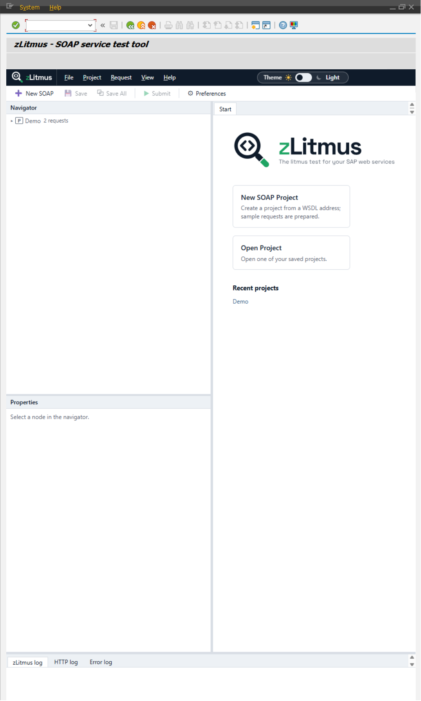
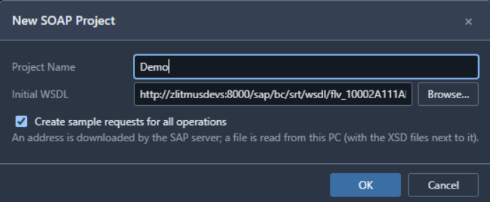
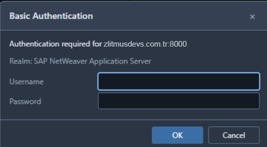
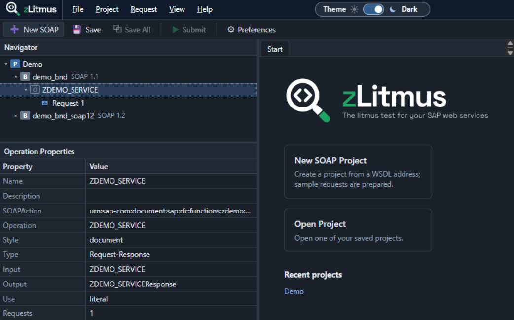
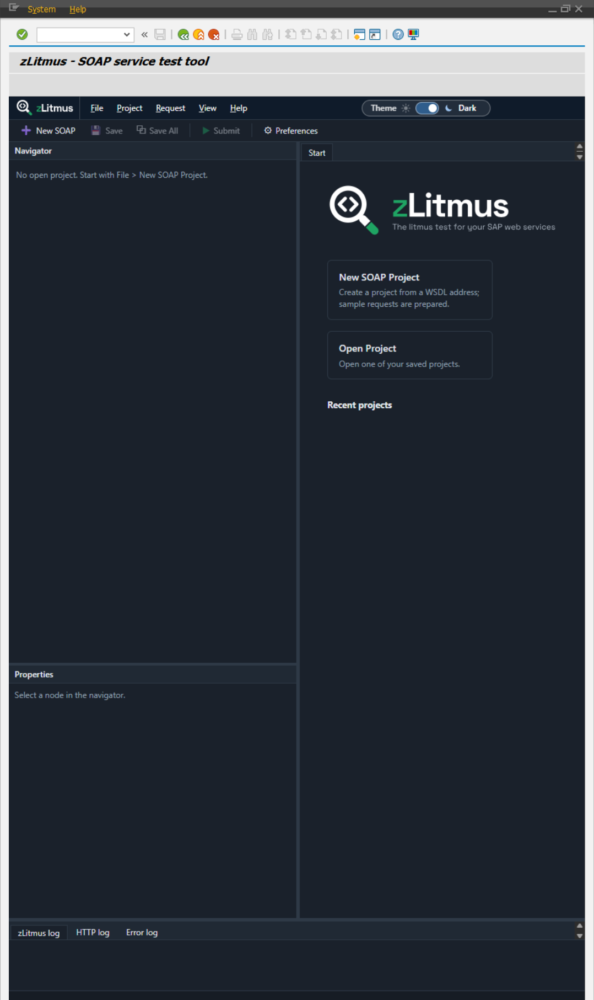
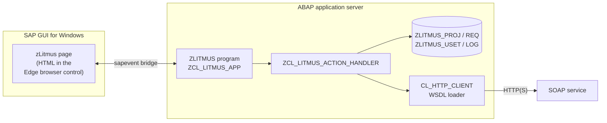

<div align="center">

<picture>
  <source media="(prefers-color-scheme: dark)" srcset="assets/logo/zlitmus-logo/svg/lockup/zlitmus-horizontal-tagline-on-dark.svg">
  
</picture>

### Test SOAP web services right inside SAP GUI.

No extra tools on the PC. Every request leaves from your SAP application server.

**English** · [Türkçe](README.tr.md)

[](LICENSE)
[](#requirements)
[](#requirements)
[](https://abapgit.org)
[](web/dist/zlitmus.html)
[](#quality)

[Features](#features) ·
[Screenshots](#screenshots) ·
[Installation](#installation) ·
[Quick start](#quick-start) ·
[How it works](#how-it-works) ·
[Security](#security)

<br>



</div>

<br>

## Why zLitmus

Testing a SOAP service from SAP usually means installing a separate test tool on a PC, asking for firewall rules from the PC to the service, or writing a throw-away ABAP report. **zLitmus** brings the whole test workflow into SAP GUI:

- 🧪 **A complete SOAP test workflow, inside SAP GUI.** Start transaction `ZLITMUS`, create a *New SOAP Project* from a WSDL address or a WSDL file, and every operation gets a ready-to-send sample request.
- 🛰️ **The call leaves from the SAP server.** Requests are sent with `CL_HTTP_CLIENT`, so you test exactly what your ABAP programs will see: the same network, proxy, SSL client identity (STRUST) and DNS.
- 💾 **Projects are SAP data.** Projects, requests, endpoints and preferences are stored per user in tables; nothing is kept on the PC. The litmus mark turns **green** for a pass and **red** for a fault.

## Features

<table>
<tr>
<td width="50%" valign="top">

#### 📥 Projects from WSDL
- WSDL from an address **or a file on the PC** (*Browse…*); XSD files next to it are read too
- `wsdl:import`, `xsd:import`, `xsd:include`, `xsd:redefine` (up to 40 documents)
- Basic authentication for protected WSDLs (SAP `/sap/bc/srt/wsdl/...`)
- SOAP 1.1 and SOAP 1.2 bindings, document and RPC style
- One *Request 1* sample per operation and binding, saved automatically
- Project name proposed from the address or file name

</td>
<td width="50%" valign="top">

#### ✉️ Requests and responses
- Coloured XML editor; format, re-create from the template
- Auto headers (`Content-Type`, `SOAPAction`) plus your own headers
- Basic authentication per request; the password is kept for the session only
- Encoding per request (UTF-8, ISO-8859-9, windows-1254, ...), timeout per request
- Formatted, coloured response with raw view, headers, sent request, SOAP fault detection
- Export request and response as XML files

</td>
</tr>
<tr>
<td valign="top">

#### 🧭 Familiar project workspace
- Navigator: project › binding › operation › request; saved projects listed at start
- Properties panel per node (Project / Interface / Operation / Request Properties), resizable columns
- Binding window: Overview, Service Endpoints (add, edit, assign to all requests), WSDL Content
- Tabs, draggable request | response divider, horizontal or vertical layout
- Menus with keyboard mnemonics and shortcuts (`Ctrl+Enter`, `Ctrl+S`, `F5` ...)
- zLitmus log, HTTP log and error log

</td>
<td valign="top">

#### 🏢 Built for SAP landscapes
- One abapGit pull: classes, program, transaction, tables, GUI status and the page (MIME)
- Projects belong to their owner; WSDL documents cached (compressed) with the project
- Audit log `ZLITMUS_LOG` (method, URL, status, time, size), no bodies and no passwords
- Hints for SSL, ICM, DNS, timeout and connection errors
- Light and dark theme, remembered per user
- Turkish logon → Turkish UI; every other language → English

</td>
</tr>
</table>

## Screenshots

<table>
<tr>
<td width="50%"><p align="center"><sub><b>In SAP GUI</b> · dark theme, saved projects at start</sub></p></td>
<td width="50%"><p align="center"><sub><b>Light theme</b> · the choice is remembered per user</sub></p></td>
</tr>
<tr>
<td><p align="center"><sub><b>New SOAP Project</b> · WSDL address or file (Browse…)</sub></p></td>
<td><p align="center"><sub><b>Protected WSDL</b> · Basic Authentication</sub></p></td>
</tr>
<tr>
<td><p align="center"><sub><b>Operation Properties</b> · SOAPAction, style, type, input, output</sub></p></td>
<td><p align="center"><sub><b>Start page</b> · new project, open project, recent projects</sub></p></td>
</tr>
</table>

## Requirements

| | Minimum | Tested on |
| --- | --- | --- |
| **SAP system** | SAP NetWeaver / S/4HANA with ABAP 7.55 syntax (`FIND PCRE`) | SAP_BASIS 7.56 |
| **SAP GUI** | SAP GUI for Windows 7.70 with the **Edge (WebView2)** browser control | SAP GUI for Windows, Edge control |
| **Installer** | [abapGit](https://abapgit.org) (standalone or developer edition) | abapGit standalone |
| **Network** | ICM HTTP/HTTPS outbound from the application server to the services you test | |
| **Authorization** | `S_TCODE` for transaction `ZLITMUS` | |

> [!NOTE]
> The browser control is set in *SAP GUI Options › Interaction Design › Control Settings › Browser Control*. zLitmus does not run in SAP GUI for HTML or SAP GUI for Java.

## Installation

zLitmus is installed with **[abapGit](https://abapgit.org)**. One pull brings every ABAP object, the four tables, transaction `ZLITMUS`, the GUI status and the page itself (MIME repository, `/SAP/PUBLIC/ZLITMUS/zlitmus.html`).

1. **Create a package**, for example `$ZLITMUS` (local) or `ZLITMUS` (transportable).
2. **Clone with abapGit**
   - *Online:* abapGit › **New Online** › URL `https://github.com/abdullahatan/zLitmus` › your package › **Pull**.
   - *Offline* (no internet on the SAP server): download this repository as ZIP (**Code › Download ZIP**), then abapGit › **New Offline** › your package › **Import ZIP**.
3. **Activate** all objects when abapGit asks.
4. **Start** transaction **`ZLITMUS`**. The page opens with the start page; *Help › About* shows the version.

> [!TIP]
> If the page is missing or outdated, `ZLITMUS` shows an **Install / update page** button (later: *File › Install / Update Page…*). Select [`web/dist/zlitmus.html`](web/dist/zlitmus.html) from this repository. Projects and settings are not touched.

**Updating** is the same pull again. Your projects, requests and preferences are stored in tables and are kept.

## Quick start

1. **File › New SOAP Project** (or the *New SOAP* button).
2. Paste a WSDL address, for example `http://host:8000/sap/bc/srt/wsdl/.../bndg_url/...?sap-client=100`, or press **Browse…** and pick a `.wsdl` file. The project name is proposed for you.
3. If the WSDL is protected, enter your user and password in the **Basic Authentication** dialog (used once, never saved).
4. Open **Request 1** under an operation, fill the values and press **Submit** (`Ctrl+Enter`).
5. The status line shows **HTTP 200 OK**, the response time and size; the litmus mark is green. A SOAP fault turns it red and is listed in the error log.

Useful next steps: add endpoints in the binding window (double-click the binding), set *Authentication Type = Basic* in Request Properties, export request / response with **Export**.

## How it works



The page is a single, self-contained HTML file stored in the MIME repository. Every action of the page (create project, send request, save ...) is posted to the program as a SAP GUI event; `ZCL_LITMUS_ACTION_HANDLER` does the work and the page is shown again with the answer. The WSDL is parsed and the sample requests are generated in the page; the HTTP calls are made by the application server. The page ↔ ABAP contract is described in [`docs/bridge-contract.md`](docs/bridge-contract.md).

## Security

- **Requests come from the SAP server.** Anyone who may start `ZLITMUS` can call every address the application server can reach. Give the transaction only to the people who need it.
- **Passwords are never stored.** WSDL and request passwords live in the session only; they are not written to tables, logs or projects. `Authorization` headers are masked in the sent-request view and in the log.
- **Audit log.** `ZLITMUS_LOG` records user, time, method, URL (secrets in the query are masked), status, duration and size; no request or response bodies.
- **Local files.** A WSDL file is read from the PC only when you choose it; `file:` references are followed only from a local WSDL, never from a remote one.

## Repository layout

```text
.
├── .abapgit.xml            abapGit settings (STARTING_FOLDER /src/)
├── src/                    ABAP objects: classes, interfaces, program, transaction, tables, page (MIME)
├── web/
│   ├── src/                page source (vanilla JavaScript + CSS, no framework)
│   ├── build.mjs           bundles src/ into dist/zlitmus.html
│   ├── dist/zlitmus.html   the page (also inside src/ as MIME object)
│   └── test/               jsdom tests: menus, texts, WSDL templates, bridge, flows, recorded SAP replies
├── docs/                   bridge contract, screenshots
└── assets/logo/            logo set (SVG / PNG / favicon)
```

## Building the page

Only needed if you change the page itself. Requires Node.js 18+.

```bash
cd web
npm install          # jsdom, used by the tests only
npm run build        # -> dist/zlitmus.html
npm test             # build + all tests
```

Open `web/dist/zlitmus.html` in a browser to try it without SAP: a mock answers the actions, and the sample WSDLs `mock://fixtures/calc.wsdl`, `rpc.wsdl`, `sap.wsdl` and `imp.wsdl` are built in. Install the new page with *File › Install / Update Page…* in `ZLITMUS`, or replace the MIME object in `src/` and pull.

## Quality

| Test suite | Tests | Result |
| --- | ---: | :---: |
| ABAP Unit: action handler, project / settings repositories (OSQL test doubles), WSDL loader, URL resolution, bridge, texts, audit log | 65 | ✅ |
| Page (Node + jsdom): menus and shortcuts, texts TR/EN, WSDL templates (snapshots), bridge payloads, end-to-end flows, replies recorded from a real SAP service | 59 | ✅ |

## License

[MIT](LICENSE).

<div align="center">
<br>

<br>
<sub>The litmus test for your SAP web services.</sub>
</div>
