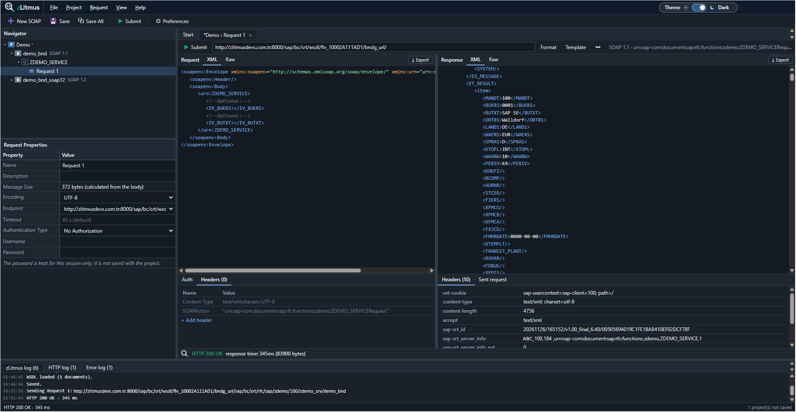
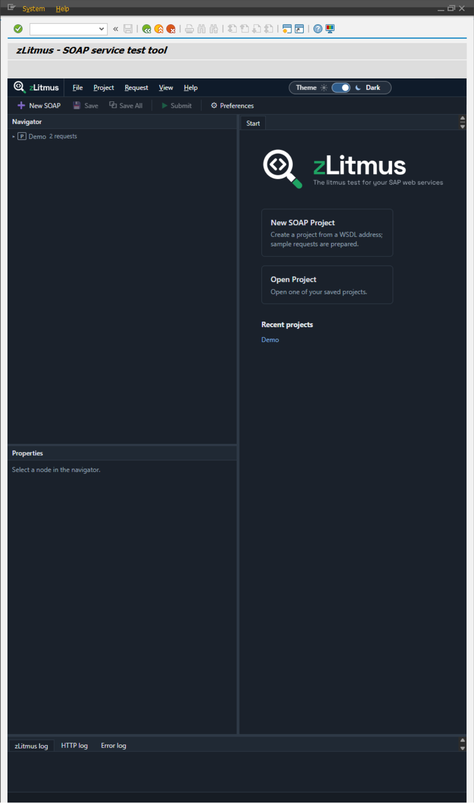
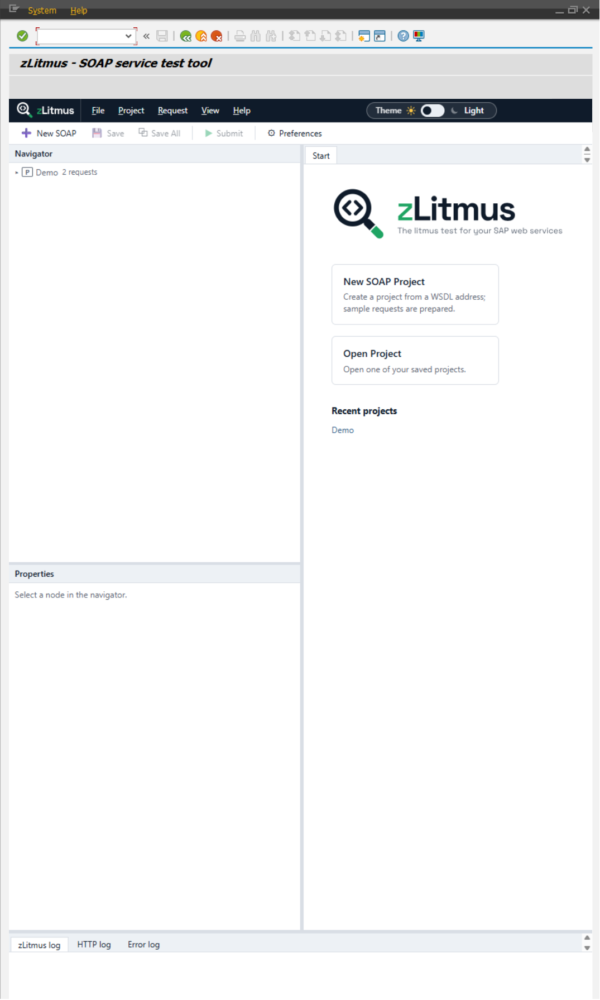
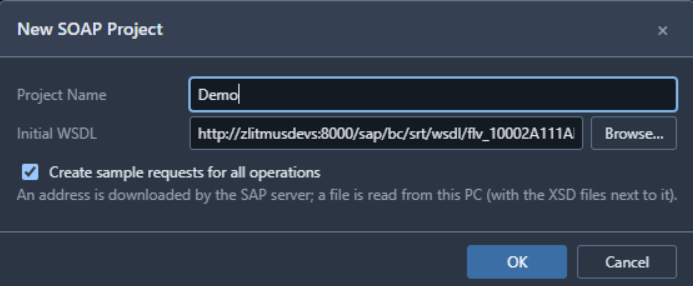
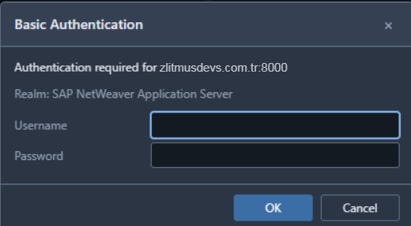
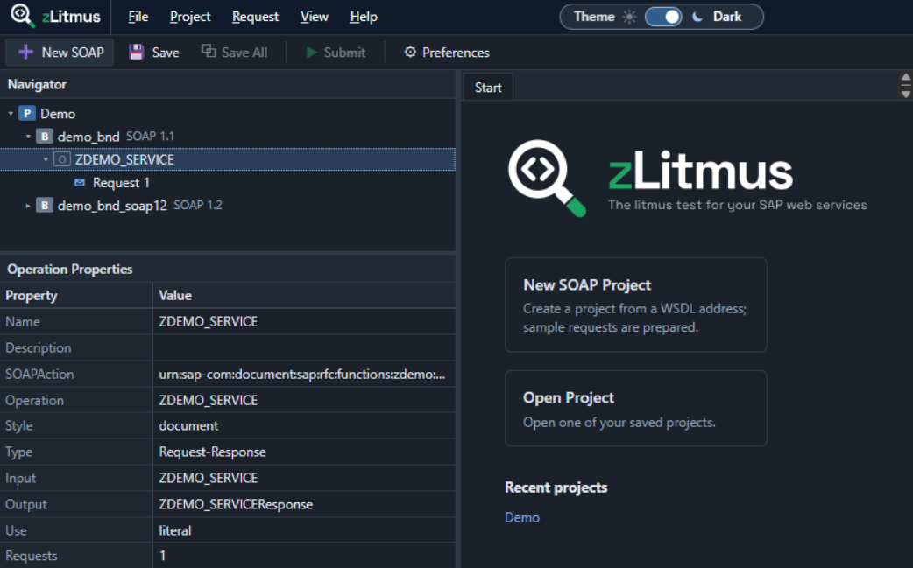
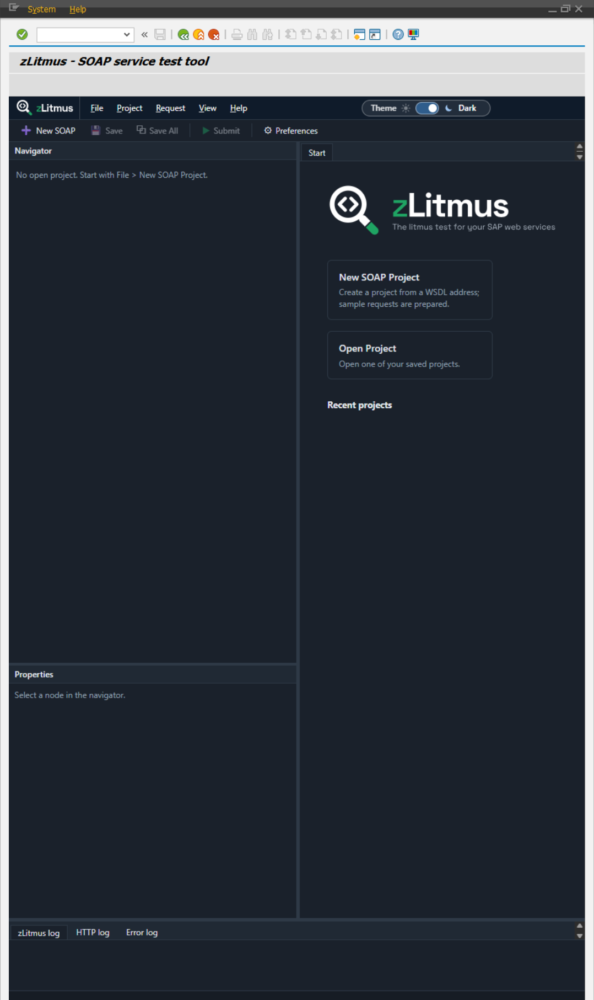
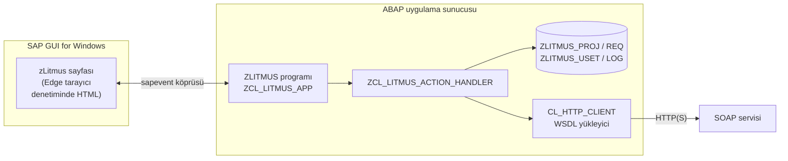

<div align="center">

<picture>
  <source media="(prefers-color-scheme: dark)" srcset="assets/logo/zlitmus-logo/svg/lockup/zlitmus-horizontal-tagline-on-dark.svg">
  
</picture>

### SOAP servislerini doğrudan SAP GUI içinde test edin.

PC'ye ek araç kurmanıza gerek yok. Her istek SAP uygulama sunucunuzdan çıkar.

[English](README.md) · **Türkçe**

[](LICENSE)
[](#gereksinimler)
[](#gereksinimler)
[](https://abapgit.org)
[](web/dist/zlitmus.html)
[](#kalite)

[Özellikler](#özellikler) ·
[Ekran görüntüleri](#ekran-görüntüleri) ·
[Kurulum](#kurulum) ·
[Hızlı başlangıç](#hızlı-başlangıç) ·
[Nasıl çalışır](#nasıl-çalışır) ·
[Güvenlik](#güvenlik)

<br>



</div>

<br>

## Neden zLitmus

SAP'den bir SOAP servisini test etmek genellikle bir PC'ye ayrı bir test aracı kurmak, PC'den servise firewall izni istemek ya da tek kullanımlık bir ABAP raporu yazmak demektir. **zLitmus** test akışının tamamını SAP GUI'ye taşır:

- 🧪 **Eksiksiz bir SOAP test akışı, SAP GUI içinde.** `ZLITMUS` işlem kodunu başlatın, bir WSDL adresinden ya da WSDL dosyasından *Yeni SOAP Projesi* oluşturun; her operasyon için gönderilmeye hazır örnek istek gelir.
- 🛰️ **Çağrı SAP sunucusundan çıkar.** İstekler `CL_HTTP_CLIENT` ile gönderilir; ABAP programlarınızın göreceği ağı, proxy'yi, SSL istemci kimliğini (STRUST) ve DNS'i birebir test edersiniz.
- 💾 **Projeler SAP verisidir.** Projeler, istekler, endpoint'ler ve tercihler kullanıcı bazında tablolarda tutulur; PC'de hiçbir şey kalmaz. Turnusol işareti başarıda **yeşil**, hatada **kırmızı** olur.

## Özellikler

<table>
<tr>
<td width="50%" valign="top">

#### 📥 WSDL'den proje
- WSDL bir adresten **ya da PC'deki bir dosyadan** (*Gözat…*); yanındaki XSD dosyaları da okunur
- `wsdl:import`, `xsd:import`, `xsd:include`, `xsd:redefine` (en fazla 40 belge)
- Korumalı WSDL'ler için Basic Authentication (SAP `/sap/bc/srt/wsdl/...`)
- SOAP 1.1 ve SOAP 1.2 binding'leri, document ve RPC stili
- Her operasyon ve binding için *Request 1* örneği, otomatik kaydedilir
- Proje adı adresten ya da dosya adından önerilir

</td>
<td width="50%" valign="top">

#### ✉️ İstek ve yanıt
- Renkli XML editörü; biçimlendir, şablondan yeniden oluştur
- Otomatik header'lar (`Content-Type`, `SOAPAction`) ve kendi header'larınız
- İstek bazında Basic Authentication; şifre yalnızca oturum boyunca tutulur
- İstek bazında kodlama (UTF-8, ISO-8859-9, windows-1254, ...) ve zaman aşımı
- Biçimli, renkli yanıt; ham görünüm, header'lar, gönderilen istek, SOAP Fault tespiti
- İstek ve yanıtı XML dosyası olarak dışa aktarma

</td>
</tr>
<tr>
<td valign="top">

#### 🧭 Tanıdık proje çalışma alanı
- Gezgin: proje › binding › operasyon › istek; kayıtlı projeler açılışta listelenir
- Düğüme göre Özellikler paneli (Proje / Interface / Operasyon / Request Özellikleri), boyutlanabilir sütunlar
- Binding penceresi: Genel Bakış, Servis Endpoint'leri (ekle, düzenle, tüm isteklere ata), WSDL İçeriği
- Sekmeler, sürüklenebilir istek | yanıt ayırıcısı, yatay ya da dikey yerleşim
- Klavye kısayollu menüler (`Ctrl+Enter`, `Ctrl+S`, `F5` ...)
- zLitmus logu, HTTP logu ve hata logu

</td>
<td valign="top">

#### 🏢 SAP ortamları için
- Tek abapGit pull: sınıflar, program, işlem kodu, tablolar, GUI status ve sayfa (MIME)
- Projeler sahibine aittir; WSDL belgeleri projeyle birlikte sıkıştırılarak saklanır
- Denetim logu `ZLITMUS_LOG` (metot, URL, durum, süre, boyut); gövde ve şifre yok
- SSL, ICM, DNS, zaman aşımı ve bağlantı hataları için ipuçları
- Açık ve koyu tema, kullanıcı bazında hatırlanır
- Türkçe oturum → Türkçe arayüz; diğer bütün diller → İngilizce

</td>
</tr>
</table>

## Ekran görüntüleri

<table>
<tr>
<td width="50%"><p align="center"><sub><b>SAP GUI içinde</b> · koyu tema, açılışta kayıtlı projeler</sub></p></td>
<td width="50%"><p align="center"><sub><b>Açık tema</b> · seçim kullanıcı bazında hatırlanır</sub></p></td>
</tr>
<tr>
<td><p align="center"><sub><b>Yeni SOAP Projesi</b> · WSDL adresi ya da dosyası (Gözat…)</sub></p></td>
<td><p align="center"><sub><b>Korumalı WSDL</b> · Basic Authentication</sub></p></td>
</tr>
<tr>
<td><p align="center"><sub><b>Operasyon Özellikleri</b> · SOAPAction, stil, tür, girdi, çıktı</sub></p></td>
<td><p align="center"><sub><b>Başlangıç sayfası</b> · yeni proje, proje aç, son projeler</sub></p></td>
</tr>
</table>

<sub>Ekran görüntüleri İngilizce oturumdan alınmıştır; Türkçe oturumda arayüz Türkçedir.</sub>

## Gereksinimler

| | En az | Test edilen |
| --- | --- | --- |
| **SAP sistemi** | ABAP 7.55 sözdizimli SAP NetWeaver / S/4HANA (`FIND PCRE`) | SAP_BASIS 7.56 |
| **SAP GUI** | **Edge (WebView2)** tarayıcı denetimli SAP GUI for Windows 7.70 | SAP GUI for Windows, Edge denetimi |
| **Kurulum aracı** | [abapGit](https://abapgit.org) (standalone ya da developer edition) | abapGit standalone |
| **Ağ** | Uygulama sunucusundan test edilen servislere ICM HTTP/HTTPS çıkışı | |
| **Yetki** | `ZLITMUS` işlem kodu için `S_TCODE` | |

> [!NOTE]
> Tarayıcı denetimi *SAP GUI Seçenekleri › Etkileşim Tasarımı › Denetim Ayarları › Tarayıcı Denetimi* altında seçilir. zLitmus SAP GUI for HTML ve SAP GUI for Java'da çalışmaz.

## Kurulum

zLitmus **[abapGit](https://abapgit.org)** ile kurulur. Tek bir pull; bütün ABAP nesnelerini, dört tabloyu, `ZLITMUS` işlem kodunu, GUI status'u ve sayfanın kendisini (MIME deposu, `/SAP/PUBLIC/ZLITMUS/zlitmus.html`) getirir.

1. **Bir paket oluşturun**, örneğin `$ZLITMUS` (yerel) ya da `ZLITMUS` (transport edilebilir).
2. **abapGit ile alın**
   - *Online:* abapGit › **New Online** › URL `https://github.com/abdullahatan/zLitmus` › paketiniz › **Pull**.
   - *Offline* (SAP sunucusunda internet yoksa): bu depoyu ZIP olarak indirin (**Code › Download ZIP**), ardından abapGit › **New Offline** › paketiniz › **Import ZIP**.
3. abapGit sorduğunda bütün nesneleri **etkinleştirin**.
4. **`ZLITMUS`** işlem kodunu **başlatın**. Sayfa başlangıç ekranıyla açılır; sürümü *Yardım › Hakkında* gösterir.

> [!TIP]
> Sayfa eksik ya da eskiyse `ZLITMUS` bir **Sayfayı kur / güncelle** düğmesi gösterir (sonrasında: *Dosya › Sayfayı Kur / Güncelle…*). Bu depodaki [`web/dist/zlitmus.html`](web/dist/zlitmus.html) dosyasını seçin. Projelere ve ayarlara dokunulmaz.

**Güncelleme** aynı pull'dur. Projeleriniz, istekleriniz ve tercihleriniz tablolarda durduğu için korunur.

## Hızlı başlangıç

1. **Dosya › Yeni SOAP Projesi** (ya da *Yeni SOAP* düğmesi).
2. Bir WSDL adresi yapıştırın, örneğin `http://host:8000/sap/bc/srt/wsdl/.../bndg_url/...?sap-client=100`, ya da **Gözat…** ile bir `.wsdl` dosyası seçin. Proje adı sizin için önerilir.
3. WSDL korumalıysa **Basic Authentication** penceresine kullanıcı adınızı ve şifrenizi girin (bir kez kullanılır, kaydedilmez).
4. Bir operasyonun altındaki **Request 1**'i açın, değerleri doldurun ve **Gönder**'e basın (`Ctrl+Enter`).
5. Durum satırında **HTTP 200 OK**, yanıt süresi ve boyutu görünür; turnusol işareti yeşildir. SOAP Fault işareti kırmızı yapar ve hata loguna düşer.

Sonraki adımlar: binding penceresinde endpoint ekleyin (binding'e çift tıklayın), Request Özellikleri'nde *Yetki türü = Basic* seçin, istek / yanıtı **Dışa aktar** ile kaydedin.

## Nasıl çalışır



Sayfa, MIME deposunda duran tek ve kendi kendine yeten bir HTML dosyasıdır. Sayfanın her eylemi (proje oluştur, istek gönder, kaydet ...) programa bir SAP GUI olayı olarak gönderilir; işi `ZCL_LITMUS_ACTION_HANDLER` yapar ve sayfa yanıtla birlikte yeniden gösterilir. WSDL sayfada ayrıştırılır ve örnek istekler sayfada üretilir; HTTP çağrılarını uygulama sunucusu yapar. Sayfa ↔ ABAP sözleşmesi [`docs/bridge-contract.md`](docs/bridge-contract.md) dosyasındadır.

## Güvenlik

- **İstekler SAP sunucusundan çıkar.** `ZLITMUS`'u başlatabilen herkes, uygulama sunucusunun erişebildiği her adresi çağırabilir. İşlem kodunu yalnızca gerçekten ihtiyacı olanlara verin.
- **Şifreler hiçbir zaman saklanmaz.** WSDL ve istek şifreleri yalnızca oturumda yaşar; tablolara, loglara ve projelere yazılmaz. `Authorization` header'ı gönderilen istek görünümünde ve logda maskelenir.
- **Denetim logu.** `ZLITMUS_LOG`; kullanıcı, zaman, metot, URL (sorgudaki gizli değerler maskelenir), durum, süre ve boyutu kaydeder; istek ve yanıt gövdesi tutulmaz.
- **Yerel dosyalar.** PC'den yalnızca sizin seçtiğiniz WSDL dosyası okunur; `file:` başvuruları yalnızca yerel bir WSDL'den izlenir, uzaktaki bir WSDL'den asla.

## Depo düzeni

```text
.
├── .abapgit.xml            abapGit ayarları (STARTING_FOLDER /src/)
├── src/                    ABAP nesneleri: sınıflar, interface'ler, program, işlem kodu, tablolar, sayfa (MIME)
├── web/
│   ├── src/                sayfanın kaynağı (framework'süz JavaScript + CSS)
│   ├── build.mjs           src/'yi dist/zlitmus.html olarak paketler
│   ├── dist/zlitmus.html   sayfa (src/ içinde MIME nesnesi olarak da var)
│   └── test/               jsdom testleri: menüler, metinler, WSDL şablonları, köprü, akışlar, kayıtlı SAP yanıtları
├── docs/                   köprü sözleşmesi, ekran görüntüleri
└── assets/logo/            logo seti (SVG / PNG / favicon)
```

## Sayfayı derleme

Yalnızca sayfanın kendisini değiştirirseniz gerekir. Node.js 18+ ister.

```bash
cd web
npm install          # jsdom, yalnızca testler için
npm run build        # -> dist/zlitmus.html
npm test             # derleme + bütün testler
```

SAP olmadan denemek için `web/dist/zlitmus.html` dosyasını bir tarayıcıda açın: eylemleri bir mock yanıtlar; `mock://fixtures/calc.wsdl`, `rpc.wsdl`, `sap.wsdl` ve `imp.wsdl` örnek WSDL'leri içindedir. Yeni sayfayı `ZLITMUS` içinde *Dosya › Sayfayı Kur / Güncelle…* ile yükleyin ya da `src/` içindeki MIME nesnesini değiştirip pull edin.

## Kalite

| Test takımı | Test | Sonuç |
| --- | ---: | :---: |
| ABAP Unit: eylem işleyici, proje / ayar depoları (OSQL test double'ları), WSDL yükleyici, URL çözümleme, köprü, metinler, denetim logu | 65 | ✅ |
| Sayfa (Node + jsdom): menüler ve kısayollar, TR/EN metinler, WSDL şablonları (snapshot), köprü yükleri, uçtan uca akışlar, gerçek bir SAP servisinden kaydedilmiş yanıtlar | 59 | ✅ |

## Lisans

[MIT](LICENSE).

<div align="center">
<br>

<br>
<sub>SAP web servisleriniz için turnusol testi.</sub>
</div>
